

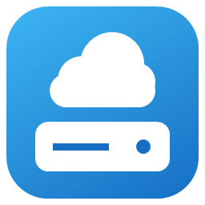

# DriveGram

**Your Telegram account, as an encrypted drive in This PC.**
 
<em>כונן ב"מחשב זה" שכל הקבצים שלו נשמרים מוצפנים בחשבון הטלגרם שלך.</em>

  

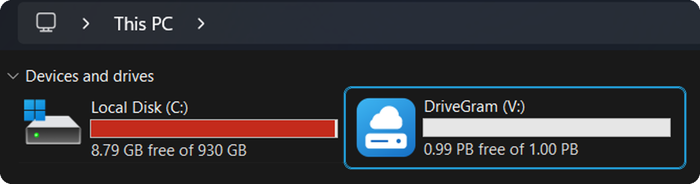

### It's just a drive. Your files live in Telegram.

 

### [⬇️ Download / הורדה](https://github.com/ori-halevi/DriveGram/releases/latest)

📖 [English](#-english) · [עברית](#-עברית)

 

## 🇬🇧 English

### What it is

DriveGram puts a new drive letter in **This PC**, say `T:`. You use it like any other disk: copy, open, save, rename, drag folders in and out. Behind the scenes every file is **encrypted on your PC** and stored in two private channels in **your own Telegram account**.

No server in the middle, no subscription, no storage plan. Just your account, your password, and a drive.

### Highlights

- 💽 **A real drive letter in This PC.** Not a website, not a sync folder: open, save and drag files in File Explorer and in every program, exactly like on `C:`.
- 🔐 **Encrypted before it leaves your PC.** Your password turns into the key (AES-256-GCM). Telegram stores encrypted pieces it cannot read, and file names are encrypted too. A **recovery key** is one click away.
- 📁 **Bigger than your disk.** Files that are not on this PC are fetched when you open them, so the drive can be far bigger than your disk. Recently used files are kept locally and open instantly.
- 🐘 **Built for big files.** Files are stored in 32 MB pieces, uploaded in parallel and in the background while the copy is still running. Edit one corner of a 50 GB file, and only that piece is uploaded again.
- 💪 **Survives the real world.** Lost connection, sleep, a crash, a reboot in the middle of an upload: it picks up where it stopped. Telegram's rate limits are respected instead of fought.
- 💻 **Several PCs, one drive.** One PC writes at a time and the others see the same files read-only. Ask for the drive and the other PC hands it over in a click. If it doesn't answer, the drive moves anyway.
- 🗑️ **Its own recycle bin.** Deleted files wait 30 days before they are gone for good.
- 🗂️ **As many drives as you like,** on one account or several. Add a second account as a backup admin, so the drive survives if the main one is lost. (Want the drive to belong to that account? See [moving ownership](docs/transfer-ownership.md).)
- 🌐 **Network drive or regular disk.** A network drive keeps backup and antivirus programs from downloading the whole drive. A regular disk works with every program. Switch at any time.
- 📤 **Export everything** to a normal folder or an external disk, whenever you want to leave or keep a second copy.
- 🇮🇱 **Hebrew and English,** right-to-left done properly.

### A look inside

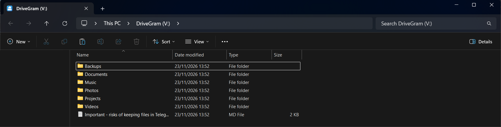
 Folders and files, in File Explorer, like on any disk
  
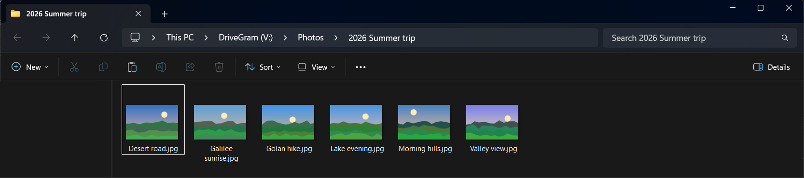
 Thumbnails, previews and opening files work as usual: what is not on this PC is fetched when needed
  
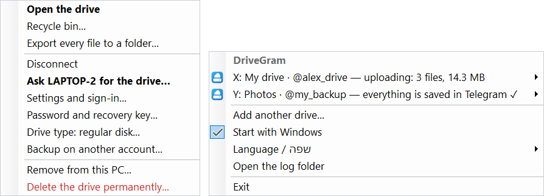
 An icon next to the clock always shows what is happening

 

<table>
<tr>
<td align="center">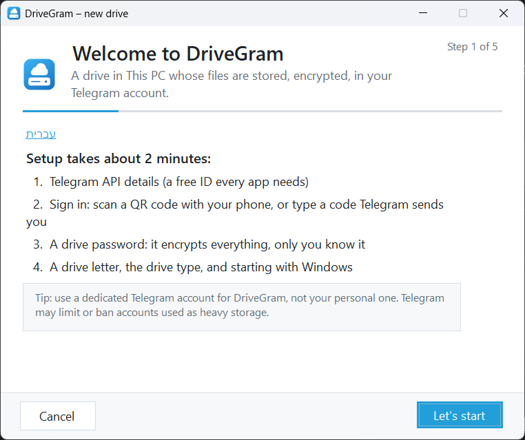 A two-minute setup</td>
<td align="center">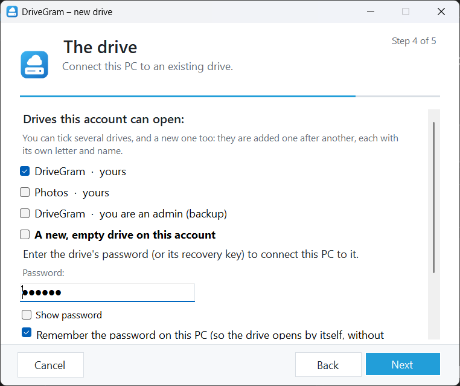 Connect several drives in one go, or create a new one</td>
</tr>
<tr>
<td align="center">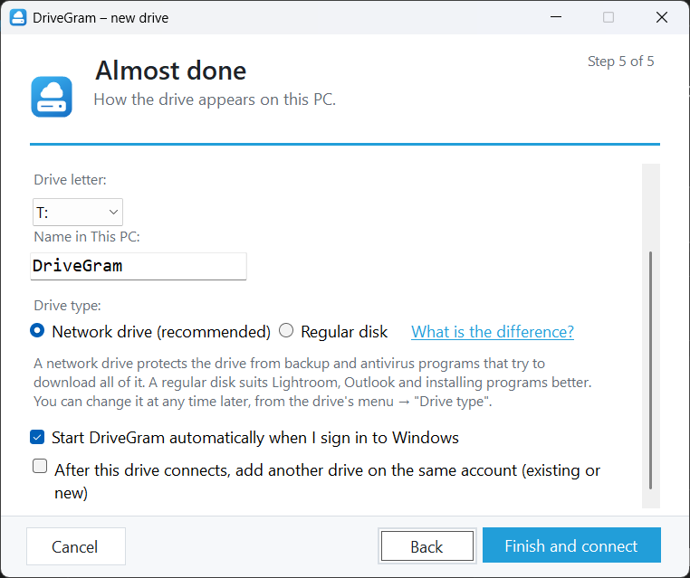 Pick a letter, a name and the drive type</td>
<td align="center">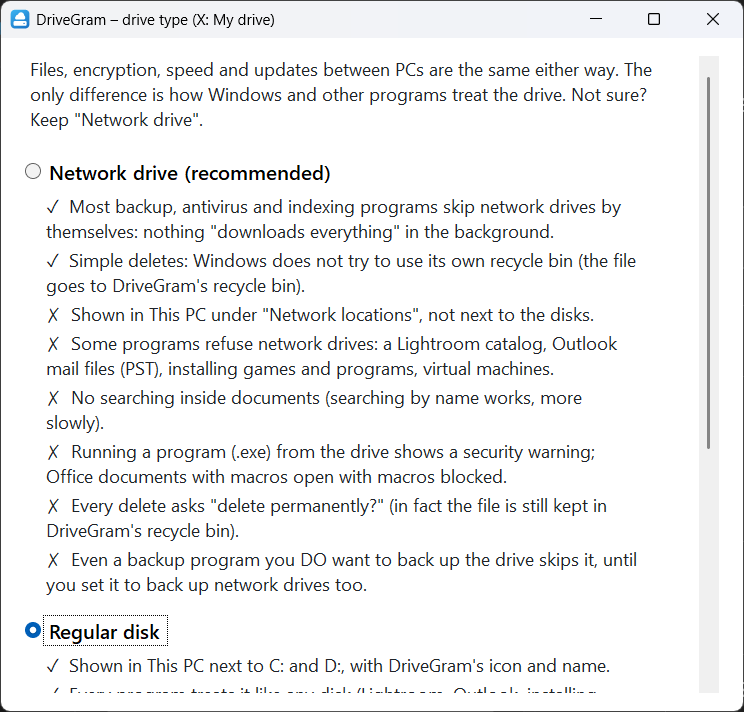 Every choice is explained in plain words</td>
</tr>
<tr>
<td align="center">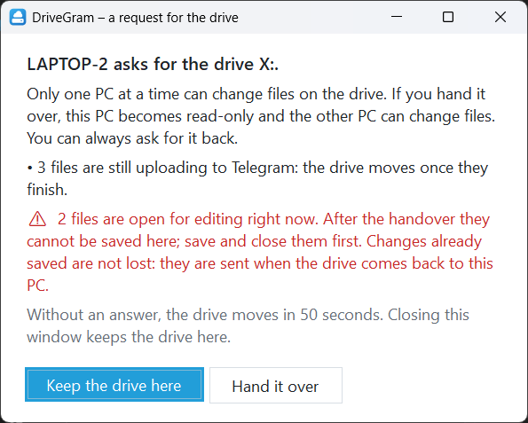 Hand the drive to another PC in a click</td>
<td align="center">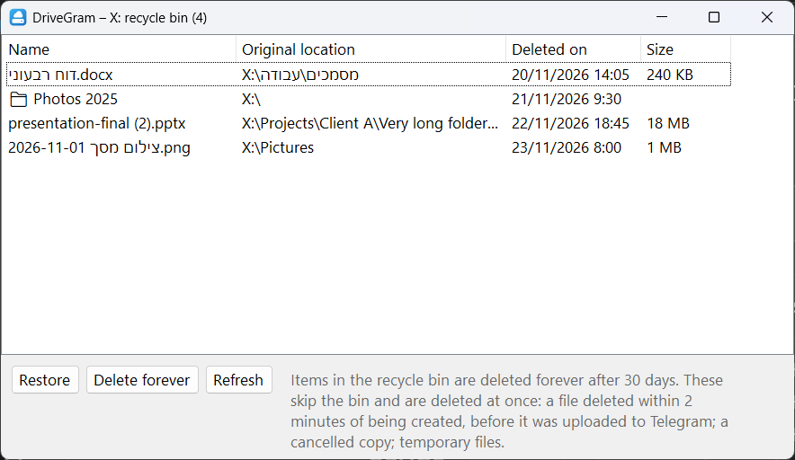 A recycle bin that keeps files for 30 days</td>
</tr>
</table>

### Getting started

1. Download and run **`DriveGram-Setup-<version>.exe`** from [Releases](https://github.com/ori-halevi/DriveGram/releases/latest). No admin rights are needed, except for a one-time install of WinFsp if it is missing.
2. The setup wizard walks you through it:
   - a free API ID from [my.telegram.org](https://my.telegram.org/apps);
   - signing in by scanning a QR code with your phone;
   - choosing a drive password.
3. That's it. The drive appears in This PC, and an icon next to the clock shows what is happening.

### Before you trust it with your files

DriveGram is honest about its trade-offs. Every new drive also gets a short note about them.

- **Your Telegram account is the storage.** If Telegram blocks or deletes the account, the files go with it. A dedicated account is recommended over your personal one.
- **It is not a backup.** Keep a second copy of what matters. The built-in export makes that easy.
- **The password cannot be recovered,** not even by DriveGram. Create a recovery key and keep it somewhere safe.
- Telegram was not built as a storage service, and it may change its rules or limits.

### For developers

- **Stack:** C# / .NET 10, [WinFsp](https://winfsp.dev), WTelegramClient, SQLite and WinForms. The installer is built with Inno Setup.
- **Build:** run `dotnet build`, then `dotnet test`. `build-installer.cmd` produces the installer.
- **Design and storage layout:** [`FORMAT.md`](FORMAT.md) describes everything stored in Telegram. With it and the password, a drive can be read without DriveGram.
- **Developer notes (Hebrew):** [`docs/DEVELOPMENT.he.md`](docs/DEVELOPMENT.he.md).

 

## 🇮🇱 עברית

**DriveGram** מוסיף כונן חדש ל"מחשב זה", למשל `T:`. עובדים איתו בסייר הקבצים כמו עם כל דיסק. מאחורי הקלעים, כל קובץ **מוצפן במחשב שלך** ונשמר בשני ערוצים פרטיים **בחשבון הטלגרם שלך**. אין שרת באמצע ואין מנוי.

- 💽 **אות כונן אמיתית ב"מחשב זה".** לא אתר ולא תיקיית סנכרון: פותחים, שומרים וגוררים קבצים בסייר ובכל תוכנה, בדיוק כמו ב־`C:`.
- 🔐 **מוצפן לפני שהוא יוצא מהמחשב.** טלגרם לא יכול לקרוא את הקבצים או את השמות שלהם. יש גם מפתח שחזור.
- 📁 **גדול מהדיסק שלך.** קבצים שלא שמורים במחשב יורדים כשפותחים אותם, אז הכונן יכול להיות גדול בהרבה מהדיסק שלך.
- 🐘 **מתאים לקבצים גדולים.** העלאה ברקע, וכשעורכים קובץ ענק עולה מחדש רק החלק ששונה.
- 💪 **עמיד.** ניתוק, שינה, קריסה או הפעלה מחדש באמצע העלאה, וההעלאה ממשיכה מאיפה שעצרה.
- 💻 **כמה מחשבים לכונן אחד.** מחשב אחד כותב, והכונן עובר ביניהם בלחיצה.
- 🗑️ **סל מחזור** ששומר קבצים 30 יום, **כמה כוננים וכמה חשבונות**, **כונן רשת או דיסק רגיל**, ו**ייצוא** של הכל לתיקייה רגילה.

 אות כונן אמיתית ב"מחשב זה", ליד הדיסקים שלך

<table>
<tr>
<td align="center">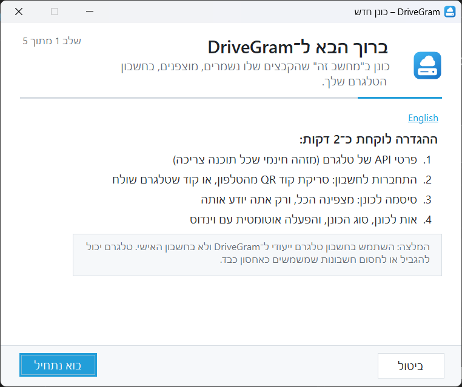 הגדרה של שתי דקות</td>
<td align="center">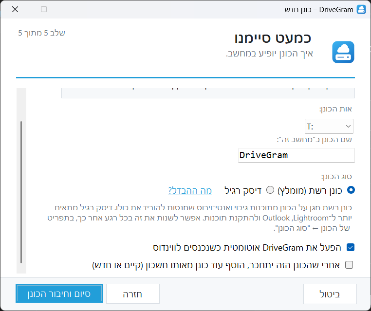 אות, שם וסוג כונן</td>
</tr>
</table>

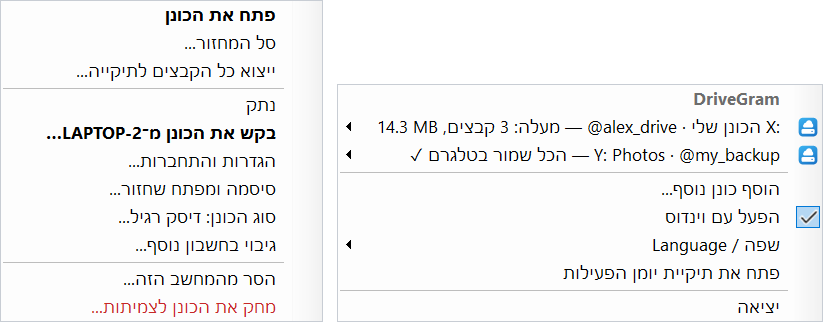

**חשוב לדעת:** החשבון בטלגרם הוא מקום האחסון. אם הוא ייחסם, הקבצים יאבדו, ולכן מומלץ להשתמש בחשבון ייעודי. זה גם לא גיבוי, ואת הסיסמה אי אפשר לשחזר. כדאי ליצור מפתח שחזור.

**התקנה:** מורידים את `DriveGram-Setup-<גרסה>.exe` מ־[Releases](https://github.com/ori-halevi/DriveGram/releases/latest) ומריצים. האשף בעברית מסביר הכל.

